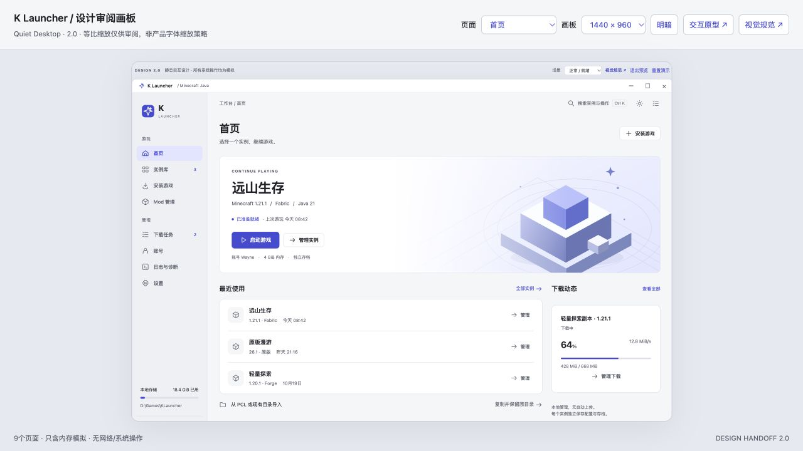

# K Launcher

Windows 11 x64 本地个人使用的 Minecraft Java 启动器。计划使用 **Rust + Tauri 2 + React + TypeScript**。下载Minecraft是核心功能，AI后置。

这是设计与后续实施共用的公开仓库。当前公开内容仅包含v2.0设计基线与交接提示词，尚未提交产品代码。

## 从这里开始

- [完整中文设计总册](docs/design/v2.0/设计总册.html)（克隆后本地打开；GitHub文件页显示HTML源码）
- [设计包说明](docs/design/v2.0/README.md)
- [实施启动提示词](prompts/IMPLEMENTATION_START.md)
- [Agent工作约定](AGENTS.md)
- [阶段任务清单](docs/design/v2.0/文档/10-实施任务清单.md)
- [实施契约与DTO](docs/design/v2.0/文档/11-实施契约与一致性决策.md)
- [页面操作追踪](docs/design/v2.0/文档/12-页面操作与实现追踪.md)

## 设计原型

克隆或下载仓库后，直接打开以下HTML。内嵌样式、SVG和内存交互均可离线浏览，不需要安装产品开发依赖。

- [九页交互原型](docs/design/v2.0/视觉原型/index.html)
- [桌面审阅画板](docs/design/v2.0/视觉原型/desktop-board.html)
- [视觉规范](docs/design/v2.0/视觉原型/visual-spec.html)

这些是静态设计稿；不会真实登录、下载、读写游戏文件或启动Java。

## 仓库结构

```text
AGENTS.md                         仓库范围工作约定
prompts/IMPLEMENTATION_START.md    发给实施agent的启动提示词
docs/design/v2.0/                  唯一设计基线：12份规格、65命令、38组操作、40条AC
implementation/README.md          阶段证据与实施记录的位置约定
```

后续产品代码在本仓库根目录按设计建立，例如src-tauri/与src/；当前尚未创建这些产品目录。阶段记录放implementation/M0/等目录，测试结果必须引用T/FR/UI-ID/AC。不要另建一个与设计脱节的产品仓库。

## 当前状态与门禁

先执行M0。分别报告基础门和认证门；认证未通过不能宣称M0/M3或P0整机完成。通过前置门的独立任务可按依赖推进，M1–M6需要实际实现与验收证据。所有产品AC均待执行；Windows原生、OAuth、DPAPI、Loader处理器和真实主菜单流程尚未联调。

名称已由用户统一为K Launcher，默认目录标识为KLauncher。本次仅更名及整理仓库，不改变v2.0功能与协议，详见[更名与仓库约定](docs/design/v2.0/更名与仓库约定.md)。


