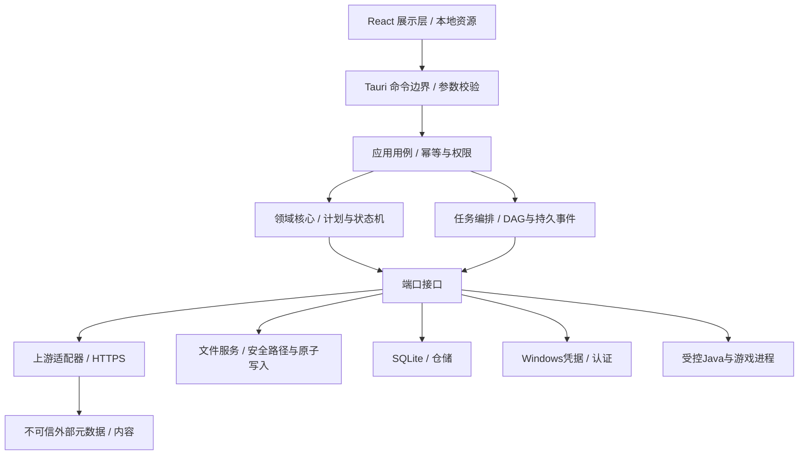

# 系统与模块架构

设计基线 2.0 · 本文中的模块、接口、路径均为未来实现契约，不是已存在的产品源码。

## 1. 分层与信任边界

React 只展示DTO和用户意图，不能持有refresh token、直接下载资源、自由读写磁盘或运行命令。Rust持有业务事实与所有网络/系统副作用。Tauri 2 只为主本地窗口授予具体能力；远程网页、Mod描述、登录站点不得获得IPC能力。来源：[Tauri Capabilities](https://v2.tauri.app/security/capabilities/)。

网络下载内容、压缩包、JAR、版本JSON、外部目录、日志均视为不可信输入。自定义Rust命令不会因启用capability就自动得到充分校验，每个命令仍需验证实例ID、允许的状态、路径令牌与revision。

## 2. 模块职责、所有权与替换边界

| 模块 | 拥有的事实 | 输入→输出 | 不得承担 |
|---|---|---|---|
| App/Shell | 窗口、系统主题、导航 | 用户意图→命令 | 业务状态机 |
| Catalog | 上游版本目录快照 | Provider+过滤→目录+新鲜度 | 创建文件 |
| VersionResolver | 版本继承、规则、库/参数 | 固定元数据→ResolvedVersion | 发起网络请求 |
| InstallPlanner | 资源/步骤/空间/兼容 | 固定选择+现有索引→InstallPlan | 实际修改实例 |
| TaskEngine | DAG执行、lease、重试、取消 | Plan→事件与终态 | 自己决定Loader版本 |
| DownloadService | HTTP、Range、限速、校验 | ArtifactSpec→VerifiedArtifact | 修改Mod配置 |
| ContentStore | 缓存对象、引用、清理 | 哈希+文件→ObjectRef | 管理存档 |
| InstanceService | 实例生命周期/revision | 创建/复制/删除→实例快照 | 保存账号secret |
| LoaderAdapters | Fabric/Forge/NeoForge/Quilt差异 | MC+Loader pin→扩展计划 | 通用UI逻辑 |
| RuntimeService | Java发现/安装/探测 | Java约束→RuntimeRef | 固定所有新版本为Java21 |
| AccountService | OAuth会话、刷新、权益快照 | AccountId→内存启动凭证 | 将token回传UI |
| LaunchService | LaunchPlan、预检、子进程 | 实例+账号→RunSession | 通过shell拼命令 |
| ContentService | Modrinth、本地识别、依赖图 | 目标实例+选择→变更计划 | 承诺完整Mod兼容 |
| ImportExport | 外部格式解析、映射、恢复 | 压缩包/目录令牌→导入计划 | 覆盖源目录 |
| Diagnostics | 日志索引、规则、脱敏 | RunId→诊断与导出预览 | 上传隐私数据 |
| Settings/Migrations | 类型配置/schema更新 | 设置差异→验证/提交 | 自动升级游戏存档 |

建议未来使用单Rust应用与内部模块，保持纯领域模块可离线测试；不采用微服务、Node后台、每个下载一个进程。依赖族固定为tokio、reqwest、serde、rusqlite（专用阻塞DB工作线程）、tracing；具体版本在T06核实并锁定。更换库族需ADR，不能让不同agent各选一套仓储。这里只定义选择，没有产品依赖文件。

React使用TanStack Query管理服务端快照请求、React局部state管理未保存表单与筛选、CSS变量管理主题；任务真相不得放在前端store。无远程React页面，无嵌入式账号表单。

## 3. Rust端口契约

| 契约 | 方法语义 | 错误/限制 |
|---|---|---|
| CatalogProvider | fetch_catalog(etag), fetch_version(id,digest) | 返回原始字节摘要、来源、缓存验证时刻 |
| LoaderProvider | list_compatible(mc), resolve(pin) | UnknownCompatibility与Unsupported区分 |
| RuntimeProvider | list(major,arch), resolve(build), probe(path_token) | 无匹配构建不自动替代其他major |
| DownloadPort | fetch(spec,cancel,progress) | VerifiedArtifact或结构化失败；不返回未验完整文件 |
| CredentialPort | store/get/delete(account_id,secret) | secret类型不可序列化到日志 |
| ProcessPort | spawn(executable,args,env,cwd), request_stop | 参数数组、受控可执行路径；返回pid+creation_time |
| FilePort | validate_root, staged_write, atomic_replace | 检查重解析点、同卷提交、目标锁 |
| Repository | transaction(expected_revision), snapshot | 乐观并发失败返回REVISION_CONFLICT |

## 4. IPC命令目录（逻辑契约）

所有命令请求：request_id（UUID）、contract_version=1、payload。所有变更命令包含idempotency_key和涉及实体的expected_revision。业务失败统一返回结构化error；UI文字由本地错误码映射，不显示上游raw token或完整认证响应。

| 命令 | 主要请求字段 | 主要响应 | 副作用/约束 |
|---|---|---|---|
| bootstrap | 无 | settings, instances_summary, active_tasks, account_summary, revision | 本地优先；网络刷新独立 |
| catalog.list | channel, query, cursor | items, next_cursor, fetched_at, stale | 只读缓存；主动刷新另传refresh=true |
| install.preview | mc_id, loader_pin?, name, root_token, java_policy | plan_id, digest, steps, bytes?, disk_required, issues, expires_at | 快照计划；不下载游戏文件 |
| install.commit | plan_id,digest,idempotency_key | task_id, instance_id | 重新核查空间、版本revision；不静默替换计划 |
| task.list/get | cursor/id | snapshot, event_cursor | 不暴露带授权URL |
| task.control | task_id, action, expected_revision | accepted, new_revision | pause/resume/cancel/retry_failed；无非法跳转 |
| instance.get/list | id/filter | InstanceDTO | 只读 |
| instance.update | id,expected_revision,patch | InstanceDTO | patch白名单；运行中禁止组件变更 |
| instance.clone/delete/restore（见11规范名） | id,options,revision | operation_id/task_id | 删除先回收；存档选项必须显式 |
| content.search | instance_id,query,facets,cursor | projects,page | 附固定兼容条件 |
| content.preview_change | instance_id,selected_versions,action | change_plan+依赖/冲突 | 不写文件 |
| content.commit_change | plan_id,digest,idempotency_key | task_id | 实例独占写锁 |
| account.begin/cancel | provider/session_id | session_id, expires_at, status | Rust打开系统浏览器；UI无授权URL自由输入 |
| account.remove/select | account_id | summary | 删除refresh secret；正在启动的会话不得被替换 |
| launch.preview/start（见11拆分字段） | instance_id,account_id,revision | preflight/run_id | start前Rust内填token；UI只拿脱敏摘要 |
| run.stop/log_page | run_id,force?/cursor/filter | status/log_page | force必须独立用户意图 |
| settings.validate/save | patch,revision | field_errors/settings | 保存前验证代理与路径；不把密码写JSON |
| import.scan/preview/commit | picker_token/selection/digest | scan/plan/task | 用户选目录产生短期令牌；前端不传任意路径 |
| diagnostics.export_preview/commit | run_id,redaction_choices | preview_id/export_file | 本地导出；无自动上传 |

以上是领域命令概览，不是可各自猜测的函数签名。**11文档与设计契约/命令目录.json定义唯一的规范命令名、请求字段、响应类型和变更规则**；12文档将页面操作绑定至该目录。

分页：默认50、最多200；大列表传摘要，日志按页64KiB。超长输入拒绝（查询≤256字符、用户名称≤64字符），不得截断后仍写入。

## 5. 事件契约与一致性

持久事件：event_id（单调序列）、entity_id、entity_revision、task_id?、kind、occurred_at（UTC）、payload、contract_version。持久kind见11第10节；task.progress是非持久通知，不使用event_id。

- 命令持久提交后才发状态事件。先订阅并缓冲，再获取同一DB读事务内的snapshot+cursor，丢弃≤cursor的缓冲事件，再调用events.read补拉。握手、保留期和分页见11文档。
- 进度通知每任务最多4次/秒，独立progress_seq并携execution_id；不增加实体revision，不用状态事件去重规则。每2秒或每8MiB持久化断点，取先到者。
- 持久事件全局游标按实际记录补拉，不按实体筛选后猜缺口；实体revision只用于快照替换。通知可丢失，状态事件通过补拉恢复。超出保留窗口返回CURSOR_EXPIRED并重做握手。
- commands accepted不代表任务完成；订阅失联不应把任务变失败。
- 离线不清空目录列表；显示上次验证时间。缓存TTL只是设计默认：版本目录15分钟、Loader30分钟、Mod搜索5分钟；允许手动刷新，服务端cache头优先。

## 6. 启动解析管线

1. 读取实例revision与锁文件；获取实例运行锁，校验路径、磁盘、组件状态。
2. 递归解析inheritsFrom（循环检测/深度≤16），保留来源；缺失父版本产生补全计划，不能靠目录名猜mainClass。
3. 评估libraries与arguments规则：有rules默认不允许，依序匹配更新allow/disallow；条件含OS、arch、版本regex和features。未理解的必要条件不得静默忽略。
4. 合并继承链：标量由子覆盖；参数按字段规则追加；库用group:artifact:classifier:extension做冲突键，显式Loader替代优先；同坐标不同内容摘要冲突时拒绝；不是简单JSON深合并。
5. 解析client jar、assetIndex、resources、logging、native classifiers；排除extract.exclude；每次运行独立natives临时目录，安全解压。
6. 根据javaVersion.majorVersion、Loader约束、用户override求交集；启动前运行受控 `java -version` 探测缓存（路径+mtime+size，5秒超时）。不能只信文件名。
7. 生成LaunchPlan：executable、args数组、受限env、cwd、classpath、资源/原生库路径、窗口参数；所有placeholder必须解析，未知必要变量阻断。
8. 授权成功后在Rust内存注入access token等敏感参数；显示/导出均脱敏。Windows命令行长度接近限制时使用经过对应Java/版本验证的argfile或classpath JAR策略，不能随意改变旧版语义。
9. 启动不经过cmd/PowerShell；捕获stdout/stderr，跟踪进程与子进程，按会话保留日志。

旧版minecraftArguments须使用经fixture验证的分词规则；不能按空格切字符串。资产virtual/map_to_resources、老版natives与旧Forge另有兼容适配，未通过样例前不能宣称通用兼容。

## 7. 架构决策记录

| ADR | 决策 | 原因/代价 |
|---|---|---|
| ADR-001 | 单进程应用+受控Java子进程 | 便于本地部署；异步和阻塞任务池需严格隔离 |
| ADR-002 | SQLite真相源+版本化实例锁文件 | DB支持任务原子事务；锁文件支持可读恢复，避免双写含糊 |
| ADR-003 | 不可变计划→执行→提交 | 能预览、审查、幂等；空间估算需保守 |
| ADR-004 | 共享缓存文件复制到可变区域 | 存档/Mod不能通过硬链接污染缓存；占用更多磁盘 |
| ADR-005 | 认证在Rust，系统浏览器PKCE | 减少渲染层泄露；需自有应用注册与接入验证 |
| ADR-006 | 实例升级先克隆 | 保留可回退版本；需额外空间和存档说明 |
| ADR-007 | 官方源优先、镜像可选且按哈希 | 性能与可核实性平衡；不能把“同文件名”当可信 |
| ADR-008 | 本地诊断规则先行，AI后置 | 不引入在线依赖与隐私默认上传 |

新决策必须写明问题、备选、证据、受影响FR/AC、迁移影响；不能以“实现方便”取消下载、事务或校验要求。

## 8. v2.0补充决策

| ADR | 冻结选择 | 验收依据 |
|---|---|---|
| ADR-009 | Task与TaskExecution分离；失败作业可新尝试，旧execution不可改写 | AC31 |
| ADR-010 | 事件订阅先缓冲，快照含游标；progress_seq独立 | AC32 |
| ADR-011 | 单实例mutation lease在接受计划时获取；与运行lease互斥 | AC33 |
| ADR-012 | 依赖投影统一复制；DPAPI用户范围secret文件；rusqlite单DB工作线程 | AC22/34 |
| ADR-013 | 中性底色+靛蓝强调，token唯一来源；设计注释移入审阅工具 | AC30/40 |

详细协议、事务恢复、契约优先级与冻结门见11；页面追踪见12。
