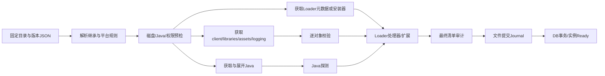

# 任务队列、下载与安装设计

FR-02/03/05/08/09/11/12 的共同执行底座。必须先实现可恢复的通用引擎，再接各资源类型。

## 1. 任务DAG与计划

Task是用户可见作业（例如“安装远山生存”）；Step是可持久重试的执行节点；Artifact是跨任务共享的内容；Attempt是一次具体HTTP尝试。不要为每个asset渲染一张用户任务卡，可折叠显示子项。

Plan必须固定MC版本、Loader build、Java build、原始元数据摘要、对象哈希、URL来源、需要空间、目标root与base_revision。计划默认15分钟有效；过期只要求重新预检与确认差异，不强迫重下相同内容。上游列表改变不允许改变正在执行的计划。

同一scope+idempotency_key+payload摘要重复提交返回原task_id；同key不同payload返回IDEMPOTENCY_CONFLICT；同一摘要对象由单个写入者下载，其他步骤订阅共享结果。取消一个订阅者不能取消仍被其他任务引用的下载。无哈希资源只按任务隔离，不因同URL/文件名就跨任务信任。

## 2. 官方Minecraft解析与对象布局

1. 根目录 `https://piston-meta.mojang.com/mc/game/version_manifest_v2.json` 提供latest、versions及每版本URL/sha1；保存原始字节，验证后再解析。
2. 对版本JSON验证manifest给出的sha1；解析downloads.client、libraries.downloads/artifact/classifiers、assetIndex、logging.client、arguments与javaVersion。
3. 对assetIndex验证version JSON中的sha1，展开objects；对象URL按 `https://resources.download.minecraft.net/<hash前2位>/<hash>`，文件内容验证sha1与期望大小。
4. 下载libraries必须按Windows/x64和features评估rules；natives不是每个库都下载所有OS；日志配置文件同样是需要验证的对象。
5. `assets`兼容布局按索引要求建立；旧版virtual/map_to_resources不能忽略。官方版本JSON、JAR与资源保持来源关系。来源见研究证据中的version样本与核实记录。

本次实测目录latest为release 26.3、snapshot 26.4-snapshot-5（2026-10-22的快照）；产品运行时必须重新读取，不将这些值写为恒定“最新”。SHA1作为上游内容完整性键使用，不把它解释为数字签名或免疫供应链攻击。

## 3. 调度与资源预算

| 资源 | 默认/上限 | 行为 |
|---|---|---|
| HTTP文件并发 | 全局8（1–16）、单域4（1–8） | 对象跨任务公平排队；认证/目录刷新保留独立小池 |
| 哈希校验 | 2个工作任务 | 顺序流式读；不将整个JAR装内存 |
| 解压/复制 | 每卷2，实例提交1 | 防止大量小文件把UI与磁盘打满 |
| Java处理器 | 全局1、实例独占 | 受控进程；10分钟无输出提示，30分钟默认超时可延长 |
| Modrinth元数据 | 本地目标≤60请求/分钟 | 服务端限额头优先；不靠多token提速 |
| 任务优先级 | 用户启动修复>当前安装>后台预取 | 加权轮转，后台不会永久饥饿 |
| 带宽 | 0不限速、全局令牌桶 | 重试流量也计入；速度用5秒平滑窗口 |

只有独立对象并行，首版不做单文件多分片下载，降低Range、哈希与文件锁复杂度。小对象批量入队，DB不必为每个进度字节写事务。规划资源超过10万文件时提示并启用分页，绝不一次将所有文件推给React。

## 4. 下载协议

- TLS强制验证；只允许HTTPS来源。认证域名不走内容镜像，不转发Authorization到跨域重定向。
- 连接超时10秒、无进展读超时30秒；大文件不设过短总时限。可配置代理；不把证书失败归为超时。
- 跟随最多5次重定向，每跳校验协议/主机/私网地址；支持上游必要CDN域，防止跳到file、localhost、内网/链路本地地址。
- 从metadata取预期size/hash；Content-Length只是传输信息，不覆盖可信元数据。无size时允许下载但显示未知总量。解压大小另算。
- 下载到staging里的`.part`，元数据记录已fsync/安全落盘的offset、强ETag或Last-Modified。checkpoint与文件长度不一致取安全已落盘边界，截断多余数据。
- 恢复使用 `Range: bytes=<offset>-` 与合适的 `If-Range`。206必须核对Content-Range起止、总量与请求；200表示从头重下，不能追加。416先核对本地长度并全量哈希，成功才完成，否则从头；ETag或对象摘要改变时废弃旧part。
- HTTP压缩与Range不混用：二进制请求identity编码；如服务不支持Range则重下整个对象。
- 完整文件流式验证元数据中最强可用摘要（mrpack优先SHA512，Java包SHA256，官方MC至少SHA1）及size。失败文件隔离，不进入缓存。
- 校验后同卷原子rename到不可变对象路径；已有对象再次比对已验证记录，冲突隔离并报HASH_COLLISION_OR_CORRUPTION。写入者lease释放后等待者可复用。

## 5. 错误分类、退避与切源

| 类型 | 自动处理 | 用户可执行操作 |
|---|---|---|
| DNS/连接重置/读超时/HTTP408/5xx | 最多初次+4次，退避1/2/4/8秒加0–30%抖动 | 重试失败项、检查代理 |
| 429 | 尊重Retry-After（秒或HTTP日期）/ratelimit reset，暂停该域队列 | 等待倒计时、稍后继续；不立即切源刷接口 |
| 401 | 内容鉴权允许一次刷新；OAuth按认证状态机 | 重新登录 |
| 403 | 不通用重试；区分API接入/权益/下载禁用 | 查看具体原因、合法上游入口 |
| 404/410 | 元数据可重新解析一次；被锁定对象不能自动换版本 | 重新生成计划、换兼容版本 |
| 摘要不符 | 当前源重试1次后可换同摘要可信源；最多3次总完整获取 | 查看来源、重试；永不“忽略校验” |
| 证书异常 | 不自动重试、不降级HTTP | 检查系统时间/代理证书链 |
| 空间/写权限/文件占用 | 停止受影响卷的写任务，保留已验缓存 | 释放空间、解占用、重新选择目录 |
| 解析schema不支持 | 保存脱敏诊断、停止该适配器 | 更新适配器或选择已验证版本 |

源优先级：官方→用户明确启用的镜像。候选镜像必须映射同一对象哈希；没有可信哈希时不自动跨源混用。BMCLAPI/MCIM等仅为未来可配置适配器候选，本包未核实其当前服务保证，不列为首版必需依赖。禁止从任意字符串替换官方域名推导所有下载URL。

## 6. 空间、暂停与取消

空间估算＝未缓存下载字节+最大展开占用+安装输出+回滚旧文件+安全余量max(1GiB,10%)，以实际目标卷分别计算。总量未知时显示“尚不能确认，至少X”，并产生SPACE_ESTIMATE_INCOMPLETE阻断项；用户可确认一个明确的每卷空间预算上限后重新预览。新版plan固定预算、余量和确认项，下载/展开超预算即NeedsAction；禁止以未知=0提交。空间不足不允许commit。过程中持续检查空间阈值，用户外部写满磁盘时停到NeedsAction。

暂停：停止分配新步骤，活动HTTP可落盘checkpoint后停止；解压可在条目边界停止；文件交换提交阶段不可暂停，按钮禁用并说明“正在保存安装结果”。

取消：持久cancel_requested→取消子步骤→杀死本任务受控处理器（必要时确认）→回滚未提交文件→Canceled。缓存可保留；自有staging保留24小时后清理。已提交完成后“取消”不能变成删除实例。取消不会删除用户在外部放入的未知文件。

退出应用：有任务时提供“退出并保存进度 / 返回”；首版不提供后台常驻服务。由app.exit_request生成退出摘要，app.exit_confirm停止调度并等待安全停点。Committing不可强制退出，保持窗口并说明正在保存；普通步骤超过10秒进入等待/操作系统强退提示，不由应用主动退出尚未落盘事务。下次按Interrupted恢复，不误报Canceled。运行中的游戏按设置默认继续，关闭启动器时清晰提示日志跟踪可能中断。

## 7. Loader与Java安装

Fabric：用meta API查询game与loader兼容组合，获取固定build的profile/json；解析mainClass/libraries/arguments，继承原版资源。Fabric API是一个Mod项目，不等于Fabric Loader，按依赖计划另外安装。

Forge/NeoForge：下载官方安装器与相关依赖，读取install_profile与version JSON，在独立兼容根执行已支持的client processors（含sides、变量、Maven坐标、outputs）；若采用官方安装器运行模式，必须在临时兼容根中测试其客户端参数与launcher profile要求。所有安装器都是可执行代码，普通权限运行、限定工作目录、记录脱敏输出，不能声称是安全沙箱。失败检查输出hash，回滚临时结果，不能仅复制universal JAR宣称成功。[Forge安装器源码](https://github.com/MinecraftForge/Installer/blob/2.0/src/main/java/net/minecraftforge/installer/actions/ClientInstall.java)。

Quilt：独立v3适配器，列为扩展；查询成功并不保证整个生态兼容。默认不作为新用户推荐Loader。

Java：优先已探测兼容本地/托管运行时，否则查询Adoptium assets API（Windows、x64、指定major、GA、hotspot、JDK ZIP）；固定返回build、package链接、SHA256与许可证信息，校验后安全解压到托管目录，再探测实际major/arch。不使用“latest二进制跳转URL”作为唯一可追踪锁。可后续支持官方runtime组件manifest，但M2先用一个验证过的Java提供商。Mojang版本中的java-runtime-delta/epsilon是组件标识，不能当下载URL。

## 8. Mod与整合包变更事务

Modrinth先取兼容版本列表，再确定具体version；项目搜索匹配不等于同一版本同时满足MC与Loader。required依赖递归求解，固定version优先；project-only依赖在实例约束下选候选并记录选择。optional默认不装；incompatible阻断；embedded视作已包含，不重复下载。环用访问集合检测；普通依赖环可折叠为强连通分量统一提交，版本约束无解时报冲突链。

本地识别读取fabric.mod.json、quilt.mod.json、META-INF/mods.toml、neoforge.mods.toml等有限大小条目；本地hash查Modrinth只在用户启用识别时进行，未知文件保留。不运行JAR“探测”。更新先diff→下载→验证→旧文件移回滚区→新文件替换→锁与DB提交。运行中只允许排队，退出后重新核查revision再提交。

mrpack：根部唯一modrinth.index.json，formatVersion=1、game=minecraft；安全解析files/hash/env/downloads/dependencies；跳过client=unsupported，optional给勾选；应用overrides后再client-overrides，不应用server-overrides；未知必需dependency阻断。路径规范、解压限制与来源域白名单见安全文档。下载缺文件时停NeedsAction，不能把不完整整合包标Ready。[mrpack规范](https://support.modrinth.com/en/articles/8802351-modrinth-modpack-format-mrpack)。

CurseForge：识别manifest和文件project/file ID；仅用户自己的获准API key可调用，不能内置他人key。作者禁止第三方下载或downloadUrl为空时显示文件清单与官方项目入口，用户补齐后按清单hash/可得元数据核验。通用ZIP仅支持识别后的格式；未知ZIP展示目录摘要，不自行猜测并运行脚本。

## 9. 恢复算法与可观测性

启动时：回收过期lease→将Running/Downloading步骤改Interrupted→核对journal→扫描part安全长度→验证已完成步骤输出→基于原plan建立剩余DAG→向用户展示“发现可恢复任务”。默认自动恢复普通可信下载，可设置关闭；安装器不确定中断状态需从干净工作区重跑相关步骤。写入实例的任务必须先恢复journal，不能直接重跑所有副作用。

每作业保留task_id、plan_digest、步骤耗时、来源、尝试次数、缓存命中与错误链；不记访问令牌或完整带签名URL。界面总进度由“已验证的已知总字节/字节总量”和当前阶段组成；不把构建时间塞入假百分比。下载完后显示“校验/安装中”，Ready才显示完成。
