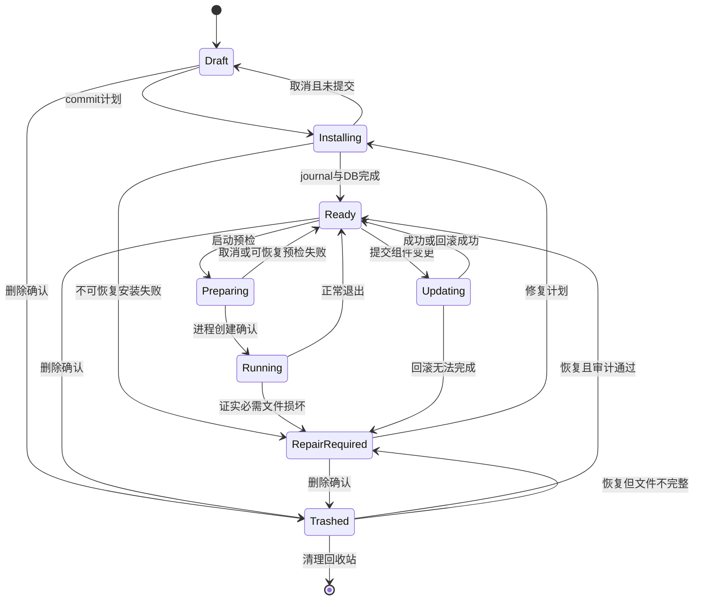
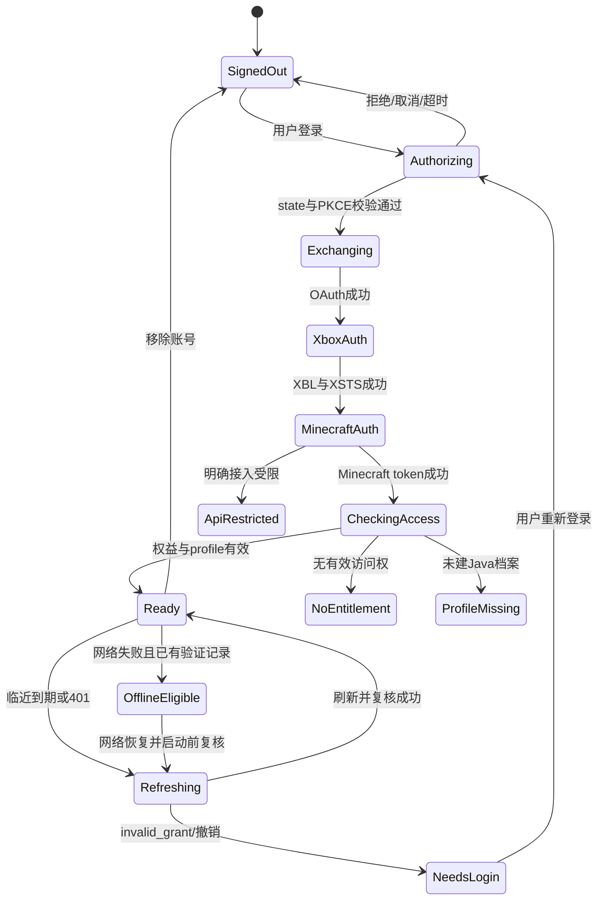

# 状态机与异常路径

约定：所有未列出的状态跃迁返回INVALID_TRANSITION，保持现有状态。已结束的执行尝试不可改写。Task是可重试的用户作业：Failed允许显式retry_failed创建新的TaskExecution，再回Queued；Succeeded/Canceled不能复活。重试保留旧execution与错误，且不得改变原计划。详见11文档。

## 1. 实例状态

普通游戏崩溃不必把实例改RepairRequired，只有文件/组件完整性证据才触发。运行态由RunSession派生，DB保留恢复记录。更新/删除/迁移遇到Running均返回INSTANCE_BUSY。崩溃后旧pid不证明游戏仍在，必须比对process_creation_time、可执行路径与会话关联，无法确认时标“进程状态未知”，提示用户核对，不杀无关进程。

## 2. 作业状态与控制语义

| 状态 | 进入条件 | 可接受动作 | 后续 |
|---|---|---|---|
| Planned（Plan状态，非Task枚举） | 计划已生成未提交 | commit、丢弃 | 创建Queued任务 |
| Queued | 任务已持久化待资源 | pause、cancel | Running/Paused/Canceling |
| Running | 下载/可并行步骤开始 | pause、cancel（可中断阶段） | Pausing/Retrying/Verifying/NeedsAction/Failed |
| Pausing | 已请求暂停 | cancel | 已checkpoint后Paused |
| Paused | 安全停点 | resume、cancel | Queued/Canceling |
| Retrying | 短暂错误等待not_before | pause、cancel、查看倒计时 | Queued |
| Verifying | 所需下载结束，审计中 | cancel（审计可停点） | Installing/Committing/NeedsAction/Failed |
| Installing | 解压/Java/处理器 | 可停点pause、cancel | Pausing/Committing/NeedsAction/Failed |
| Committing | 交换文件与DB提交 | 仅查看 | Succeeded或恢复流程；禁止中途强制暂停 |
| NeedsAction | 空间、登录、手动文件等阻塞 | 执行明确操作、cancel | 重新预检后Queued |
| Interrupted | 上次进程非正常结束 | recover、cancel | 先审计journal，再Queued/NeedsAction |
| Canceling | 取消标志持久化 | 查看 | 回滚结束后Canceled；回滚失败NeedsAction |
| Succeeded | 所有必需步骤与提交成功 | 打开实例、查看记录 | 保持终态 |
| Failed | 重试已尽或不可自动恢复 | retry_failed、查看详情、清理 | 产生新attempt后Queued，保留旧错误 |
| Canceled | 安全取消完成 | 重新生成计划 | 不复活同一取消尝试 |

步骤状态：Pending→Leased→Executing→Succeeded；异常可转RetryWait/Failed/Interrupted/Canceled。lease只保证单写，不保证副作用“恰好一次”，幂等检查与提交journal仍不可省略。

## 3. 登录状态与流程

默认系统浏览器Authorization Code+PKCE(S256)，state随机且一次性，OAuth在Rust端进行；仅绑定127.0.0.1的短期loopback端口，回调path/Host/nonce/state严格验证，使用已注册redirect URI。public client无client_secret，`consumers`与XboxLive.signin/offline_access等scope的实际可用组合在M0验证，不能复制Graph示例就认为Minecraft登录成功。

备用device code只在自有应用允许该grant且联调通过后启用。轮询遵循interval、slow_down、expires_in；取消终止轮询并擦除会话。不要收集用户密码或把验证码当账号永久标识。[Microsoft PKCE](https://learn.microsoft.com/en-us/entra/identity-platform/v2-oauth2-auth-code-flow)、[Device flow](https://learn.microsoft.com/en-us/entra/identity-platform/v2-oauth2-device-code)。

Xbox/Minecraft交换：Microsoft OAuth→XBL user token→XSTS（Minecraft relying party）→Minecraft login_with_xbox→entitlements与profile。其Minecraft专用链路并非本包声称有完整官方公开保证的接口，必须以应用注册权限和成熟客户端源码/联调为准；端点详见研究附录。entitlements空、Game Pass、profile404、token有效这些状态必须分开，不由单个HTTP200判断拥有游戏。

单账号refresh singleflight，提前5分钟刷新并保留60秒时钟偏差；invalid_grant转NeedsLogin，不死循环刷新。refresh token轮换成功先安全保存新token再更新引用；保存失败保留明确错误，不声称登录可跨重启保持。

## 4. 启动状态

Idle→Preflight→RepairPlan?→RefreshingAuth→Resolving→PreparingNatives→Spawning→Running→Exited/Failed。首版“Running”仅表示受控进程创建且持续存活，不等同于“已进世界”；“启动成功”验收仍需观察游戏主菜单。可检测窗口/已知日志作为辅助信号，不硬编码跨版本日志句子作为唯一成功标准。

Preflight到Spawning前可取消；Spawning存在竞态：取消后若进程已创建，转“正在停止本次启动”并只作用于本次run。不能让UI回Ready而Java继续不可见运行。进程退出码0显示正常结束，非0或异常中止提示诊断；缺失日志显示“无法读取日志”，不能编造崩溃原因。

启动前缺文件：产生修复预览→用户确认→任务完成再启动。后台不静默下载大体积文件；允许用户在设置启用“小型依赖自动修复”，默认关闭。

## 5. 典型异常的端到端处理

| 场景/错误码 | 系统处理 | 页面与恢复 | 验收依据 |
|---|---|---|---|
| 双击安装 / DUPLICATE_REQUEST | 同idempotency_key返回同task | 按钮立即pending，任务卡只一张 | AC-06 |
| 目录API离线 / CATALOG_STALE | 读缓存，标更新时间 | 顶部“目录暂时无法更新”；缓存版本可规划，有缺失网络文件则排队等待 | AC-02 |
| 元数据hash错 / METADATA_HASH_MISMATCH | 拒绝解析执行，换可信来源再取 | 安装页错误条，不显示猜测版本 | AC-04 |
| 服务器忽略Range / RANGE_IGNORED | 截断旧part，从0获取 | 显示“来源不支持续传，重新下载该文件” | AC-05 |
| 存盘不足 / DISK_SPACE_LOW | 停写、保留缓存、NeedsAction | 显示所需释放空间/受影响卷 | AC-07 |
| 校验失败 / HASH_MISMATCH | 隔离、有限重试、永不提交 | 任务显示来源与文件，可重试失败项 | AC-04 |
| 安装器退出非0 / PROCESSOR_FAILED | 收集脱敏日志，回滚工作区 | 下载页“构建组件失败”，旧实例仍可用 | AC-12 |
| Java不兼容 / JAVA_CONSTRAINT_CONFLICT | 求交无解阻断启动 | 实例页提供“匹配Java / 更换组件” | AC-10 |
| API403 / AUTH_API_RESTRICTED | 不离线绕过、不泛化为未购买 | 账号页说明应用接入待核实；保留已安装文件 | AC-14 |
| 无权益 / ACCOUNT_NO_ACCESS | 不进入在线Ready | 官方购买/订阅状态入口，允许换账号 | AC-14 |
| 无Java档案 / ACCOUNT_PROFILE_MISSING | 保留登录摘要，阻断完整启动 | 打开官方档案建立页面后重新检查 | AC-14 |
| 登录过期 / AUTH_REAUTH_REQUIRED | 一次刷新失败转NeedsLogin | 全局提示，相关启动停住，下载可继续 | AC-13 |
| Mod无共同兼容版本 / CONTENT_NO_COMPATIBLE_VERSION | 拒绝提交 | 展示MC/Loader/依赖冲突链 | AC-16 |
| 外部改了Mod / INSTANCE_EXTERNAL_CHANGE | 刷新索引并提升revision | 保留用户文件，要求重新预览 | AC-17 |
| 恶意ZIP / ARCHIVE_PATH_ESCAPE | 写入前拒绝整个计划 | 导入错误，实例根外无文件产生 | AC-21 |
| 应用崩溃在文件交换中 / COMMIT_INTERRUPTED | 启动先恢复journal | 恢复页显示继续/回滚结果，未审计不Ready | AC-08 |
| 迁移中目标盘拔出 / ROOT_UNAVAILABLE | 停止该卷任务，不改源根 | 重新接入后按卷ID恢复，不按同盘符猜 | AC-23 |
| 配置新schema / SCHEMA_TOO_NEW | 只读启动，禁止旧程序写 | 提示使用兼容版本，提供备份路径 | AC-24 |

## 6. 离线与服务降级

离线浏览：实例、已安装内容、日志、设置可用；搜索在线内容禁用并提供重试。曾成功在线验证的账号记录只作为受限离线使用资格，不当作永久授权证明；显式退出登录/移除凭据/明确无权益使资格失效。首次登录、API受限、账号明确被撤销不能自动进入离线模式。

本地离线启动不提供新的自定义身份、不修改UUID、不通过authlib替换绕过认证，也不承诺多人服务器可用。若目标游戏不能用该路径安全运行，则展示“当前版本不支持离线启动”，保留浏览/管理。是否允许过期Minecraft token参与本地运行须在M3固定版本验证后落实，未验证前不开放该按钮。
